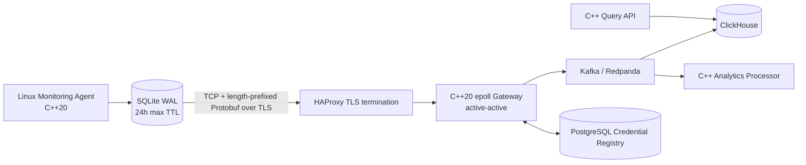

# NexStream

 

**High-Performance Distributed PC/Server Telemetry Platform**  
**Status:** Sprints 01–07 implemented and verified locally · Benchmarks not run yet

NexStream is a C++20/Linux portfolio project built to demonstrate non-blocking network I/O, memory ownership, durable delivery, distributed messaging, backpressure and performance engineering.

Linux monitoring agents sample CPU, memory, GPU, disk and network every **1 second**, persist telemetry locally, and ship batches over a framed TCP protocol through a TLS-terminating HAProxy to a horizontally scalable C++ `epoll` gateway. Kafka/Redpanda receives telemetry; ClickHouse enables historical queries.

> **This repository is a documentation-and-implementation starter, not a claim of a finished system.** See [Implementation Status](docs/STATUS.md) and [Test Results](tests/results/README.md).

## Architecture

## Highlights / design decisions

- **One `SystemMetricsSnapshot`/host/second**; metric gathering is intentionally not the primary systems challenge.
- **Short-lived connections:** one authenticated batch per TCP connection; initial target 10–50 snapshots/batch.
- **Framing:** 4-byte unsigned big-endian length, followed by one Protobuf envelope; max frame proposal 64 KiB.
- **Authentication:** HAProxy TLS 1.3 server verification and per-agent API key checked by Gateway; PostgreSQL registry + bounded local cache.
- **Reliability:** Kafka-confirmed aggregate ACK; at-least-once attempts within device retention/quota; duplicates can occur.
- **Durable local queue:** SQLite WAL, maximum retention 24h, drop-oldest when full; quota is hardware-dependent.
- **Backpressure:** bounded memory, deadlines, fast reject, retry with exponential backoff and jitter.
- **Gateway execution:** single `epoll` Reactor baseline, async Kafka producer, bounded completion queues, no blocking DB operations on Reactor.

## Repositories

| Repo | Responsibility | Current state |
|---|---|---|
| [`nexstream-contracts`](https://github.com/trungpham25051999/nexstream-contracts) | Protobuf transport & telemetry API, golden vectors, CMake package | Sprint 01 verified (`v0.1.0`) |
| [`nexstream-ingest`](https://github.com/trungpham25051999/nexstream-ingest) | TCP/epoll Gateway, PostgreSQL auth, async Kafka producer | Sprints 02, 04, 05 verified locally |
| [`nexstream-publisher`](https://github.com/trungpham25051999/nexstream-publisher) | TCP publisher, Linux metrics agent, SQLite durable queue | Sprints 03, 06 verified locally |
| [`nexstream-processor`](https://github.com/trungpham25051999/nexstream-processor) | Kafka consumer group, CPU/memory alerts, DLQ | Sprint 07 verified locally |
| [`nexstream-query`](https://github.com/trungpham25051999/nexstream-query) | HTTP API over ClickHouse | Sprint 07 verified locally |
| [`nexstream-deploy`](https://github.com/trungpham25051999/nexstream-deploy) | Compose stack, ClickHouse/PostgreSQL schemas, E2E tests, system docs | Sprint 07 hardening verified locally |

## Build and run

Each service repository documents its prerequisites, exact CMake commands, configuration and tests in its own README/BUILDING file. The full local stack (Redpanda, ClickHouse, PostgreSQL, HAProxy and all services) is started from `nexstream-deploy` with `docker-compose.sprint07.yml`.

## Roadmap

1. Transport contracts and protocol golden vectors.
2. C++ frame decoder and non-blocking epoll TCP Gateway.
3. TCP Publisher and deterministic integration tests.
4. Kafka delivery tracker and aggregate BatchAck.
5. HAProxy TLS, API-key auth, PostgreSQL registry/cache.
6. SQLite durable queue and 1Hz metrics collectors.
7. ClickHouse, analytics, multi-node failover, profiling and benchmark.

See [Roadmap](docs/ROADMAP.md), [Testing Plan](tests/TEST_PLAN.md) and [Architecture](docs/architecture/OVERVIEW.md).

## What an interviewer can evaluate

- Why TCP stream framing is necessary and how partial reads are handled.
- Lifetime-safe non-blocking sockets and Reactor fairness.
- Kafka delivery vs enqueue semantics; lost ACK and duplicate handling.
- Bounded resource consumption during overload and partial outages.
- Correct thread ownership and no use-after-free from async callbacks.
- Reproducible throughput/latency measurements with failure injection.

## Evidence

- [Test catalog](tests/TEST_CASES.md) — planned scenarios, not completed assertions.
- [Test result index](tests/results/README.md) — executed evidence lives in each service repository under `tests/results/`.
- [Benchmark methodology](docs/performance/BENCHMARK_PLAN.md) — targets are not achieved results.
- [Decisions](docs/decisions/README.md) — architecture commitments and unresolved details.

## Security scope

TLS terminates at HAProxy; backend trust boundaries and API-key provisioning are explicit. Local Docker Compose is not production-hardening. See [Security](docs/security/SECURITY_MODEL.md).

## License

Released under the [MIT License](LICENSE).
